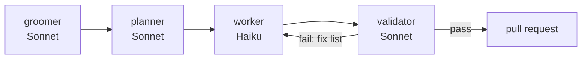

# Agent Harness

Agentic development splits work by model to keep token use down. **Sonnet 5.5** at low effort is used where judgement matters: grooming, planning and validating. **Haiku 5.5** is the workhorse and does everything else. The main session orchestrates: it delegates, passes results on, and talks to the user. It does not do the work itself.

## Agents

The project subagents live in `.claude/agents/` and are committed to the repository.

| Agent | Model | Tools | Job |
|---|---|---|---|
| `groomer` | Sonnet 5.5 (low) | no file edits | Gets issues to Ready: acceptance criteria, dependencies, size, splits ([[01-task-management]]) |
| `planner` | Sonnet 5.5 (low) | read-only | Turns one issue into merge-request-sized slices and concrete work units |
| `worker` | Haiku 5.5 | all but spawning agents | Implements one work unit, or does one chore: rebase, checks, board and PR bookkeeping, broad search |
| `validator` | Sonnet 5.5 (low) | read-only, runs checks | Checks a change against plan, acceptance criteria and the [[principles/README#Definition of done\|Definition of done]]; pass or fail |
| `designer` | Sonnet 5.5 (low) | read-only | Writes the text spec of a UI issue before planning (components, props, copy, states, tokens, a11y) against [[design-guidelines]] |

## Flow



1. **Groom** the issue if it is not Ready yet.
2. **Plan** it. The plan holds every design decision, so the worker does not have to make any. A UI issue gets a `designer` spec before planning, so the plan takes its components, states, copy, tokens and accessibility needs from that spec.
3. **Work**: one `worker` per work unit, each in the worktree of its merge request (see `AGENTS.md`, Worktrees). Independent units can run in parallel.
4. **Validate** the result. On a failure, the fix list goes back to a `worker` as the next work unit. The validator checks frontend changes by code: unit tests, e2e behaviour and axe. No agent reads, renders or compares screenshots, and there is no visual review step. The user reviews the look.
5. Mechanical steps after that also go to a `worker`: push, open the pull request, update the board, rebase stacks.

Trivial changes (typos, a one-line fix) skip the harness.

## Why this split

- Most tokens go into reading files, running commands and writing code. A cheaper model does that well once the decisions are made.
- Sonnet only reads what it needs to judge, and returns a short result: a plan, a verdict or proposed issue text.
- The main session's context stays small, because subagents return summaries instead of file contents and logs.

## Built-in subagents

Built-in agents such as `Explore` and `general-purpose` inherit the main session's model, unless a default subagent model is configured. To make Haiku the default for them, set this in your local `.claude/settings.local.json`. It is a personal setting and is not committed.

```json
{ "env": { "CLAUDE_CODE_SUBAGENT_MODEL": "claude-haiku-5-5" } }
```

The agents in `.claude/agents/` pin their own model and are not affected by it.

Related: [[01-task-management]], [[principles/README|principles]], [[design-guidelines]]
